<p></p>

# Support Zed with Database Tools

Cryptocurrency donations to Dmitry Medkov support development of this fork.

QR codes contain the receiving address only. Select the currency and network listed in the section before sending.

[Back to README](../README.md)

[USDT](#usdt), [Monero (XMR)](#monero-xmr), [Bitcoin (BTC)](#bitcoin-btc), [Gram (GRAM)](#gram), [TRON (TRX)](#tron-trx), [Ethereum (ETH)](#ethereum-eth), [Solana (SOL)](#solana-sol), [Cardano (ADA)](#cardano-ada), [BNB](#bnb), [Arbitrum (ARB)](#arbitrum-arb), [Optimism (OP)](#optimism-op), [Polygon (POL)](#polygon-pol), [Avalanche (AVAX)](#avalanche-avax)

<a id="usdt"></a>

## 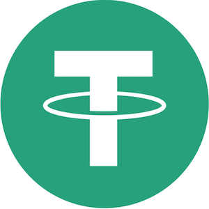 USDT

### TRON (TRC-20)

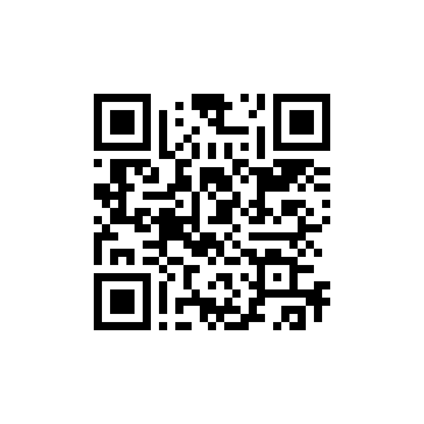

```text
TSvfFvL9ShimJSfW7JgueCEM9yvqv9o8mM
```

### Ethereum and EVM networks

The same receiving address is used on the networks below. Choose the matching network and token version in your wallet.

| Network | Token |
| --- | --- |
| Ethereum | USDT (ERC-20) |
| BNB Smart Chain | Binance-Peg USDT (BEP-20) |
| Arbitrum One | USDT0 |
| OP Mainnet | USDT0 or bridged USDT |
| Polygon PoS | USDT0 |
| Avalanche C-Chain | USDT |
| Base | Bridged USDT |
| Celo | USDT |
| Kaia | USDT |
| Kava EVM | USDT |
| Berachain | USDT0 |
| Conflux eSpace | USDT0 |
| Flare | USDT0 |
| HyperEVM | USDT0 |
| Ink | USDT0 |
| Mantle | USDT0 |
| MegaETH | USDT0 |
| Monad | USDT0 |
| Morph | USDT0 |
| Plasma | USDT0 |
| Rootstock | USDT0 |
| Sei EVM | USDT0 |
| Stable | USDT0 |
| Tempo | USDT0 |
| Unichain | USDT0 |
| X Layer | USDT0 |

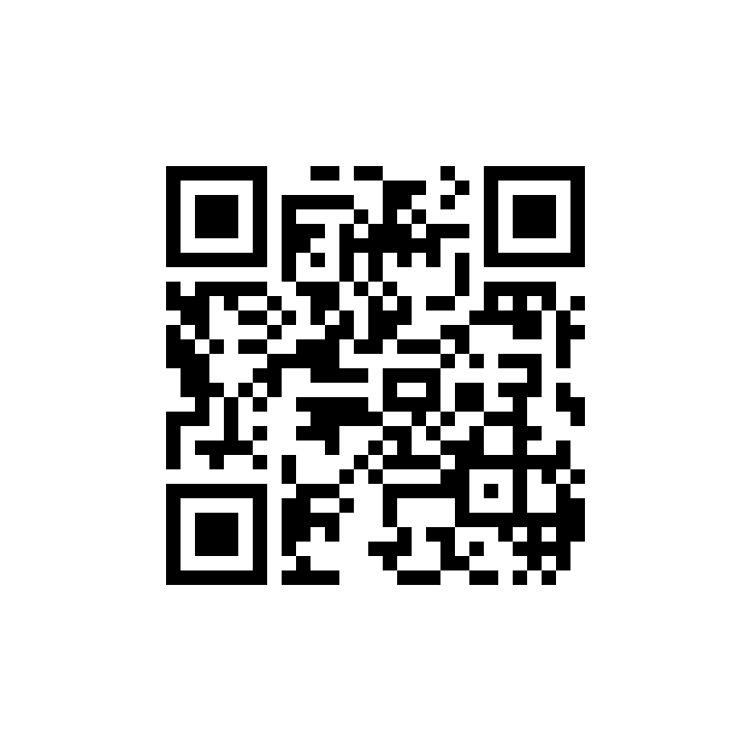

```text
0xB9EA87b0Fa9D0F56464c7cE293E9a719cE875b90
```

### Solana (SPL)

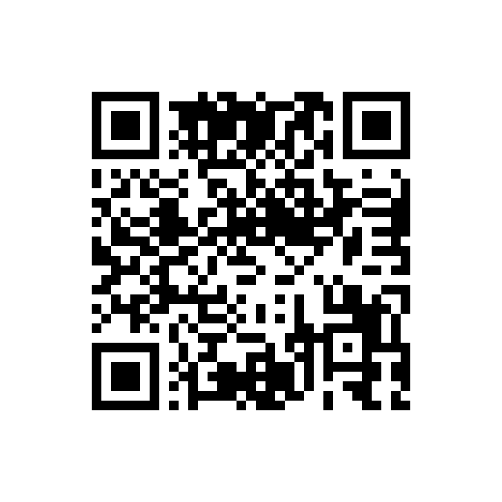

```text
4eWArtpo5KA1icSV8ZuxMXANA7UPkKGEv5Q2y3NH62mC
```

### TON (Jetton)

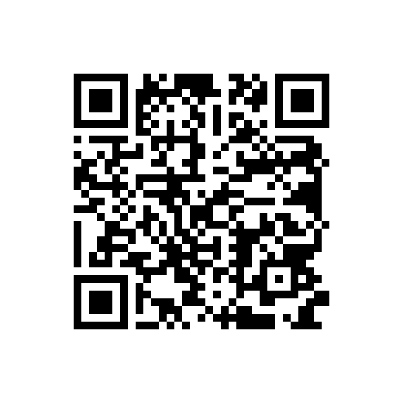

```text
UQB4lXkTAHhJjiBeMA3H4PT2fDyAMPlFVYYqZlKieTmGdirQ
```

<a id="monero-xmr"></a>

##  Monero (XMR)

**Network:** Monero

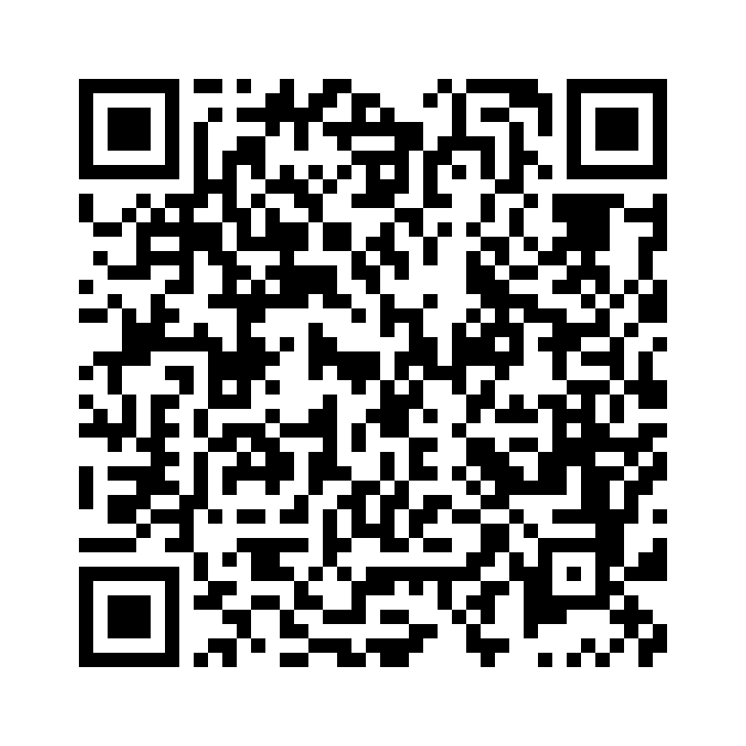

```text
42PiCsuZqGBZkTX8t6f8npTdPs6NwnSrnKqva1TGzyqVfeuTTDuYKLUjXZxtydAnkpJxdQErGmgvziP4TurpdbJbHovSJcM
```

<a id="bitcoin-btc"></a>

## 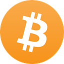 Bitcoin (BTC)

**Network:** Bitcoin

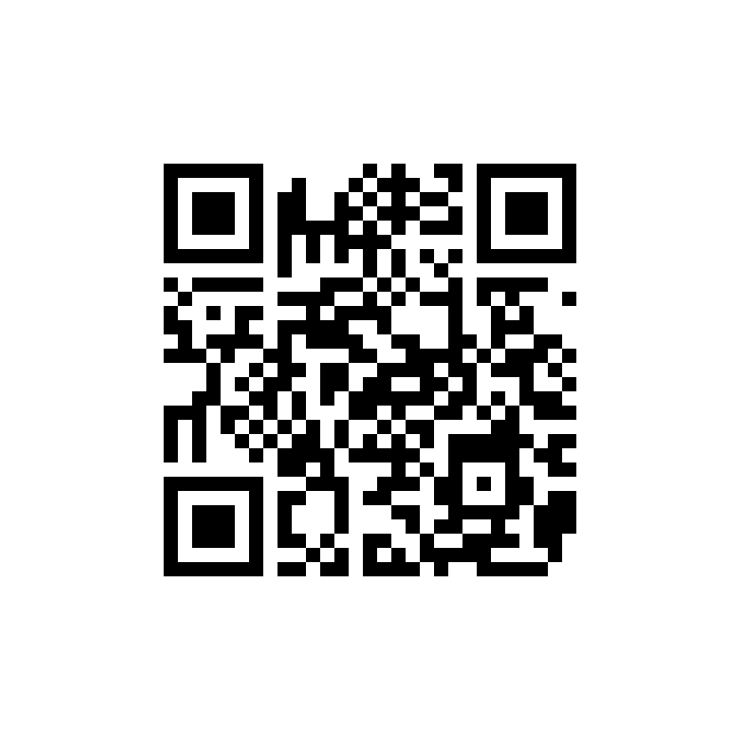

```text
bc1qmxaj6u97506ksdsursveej2gxv9vq8fws769ya
```

<a id="gram"></a>

##  Gram (GRAM)

**Network:** TON (The Open Network)

Formerly Toncoin (TON). [Official token name and branding](https://ton.org/media/).


```text
UQB4lXkTAHhJjiBeMA3H4PT2fDyAMPlFVYYqZlKieTmGdirQ
```

<a id="tron-trx"></a>

## 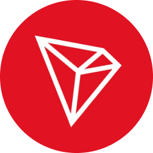 TRON (TRX)

**Network:** TRON


```text
TSvfFvL9ShimJSfW7JgueCEM9yvqv9o8mM
```

<a id="ethereum-eth"></a>

## 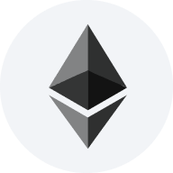 Ethereum (ETH)

**Network:** Ethereum, Arbitrum One, Base, OP Mainnet


```text
0xB9EA87b0Fa9D0F56464c7cE293E9a719cE875b90
```

<a id="solana-sol"></a>

## 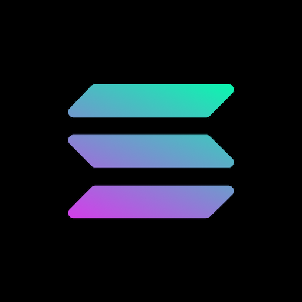 Solana (SOL)

**Network:** Solana


```text
4eWArtpo5KA1icSV8ZuxMXANA7UPkKGEv5Q2y3NH62mC
```

<a id="cardano-ada"></a>

## 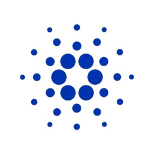 Cardano (ADA)

**Network:** Cardano

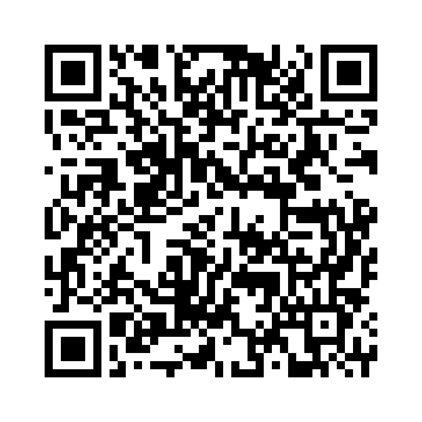

```text
addr1qyfnydj2v7m0hsx43twutqj7qlujuzkfw07ft66kaa30j04ysu7f5hddn40cq3j3fjk7g0msdjlfy2732fk3ztk5ca0qqupcck
```

<a id="bnb"></a>

## 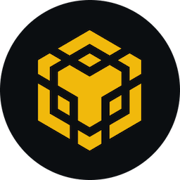 BNB

**Network:** BNB Smart Chain


```text
0xB9EA87b0Fa9D0F56464c7cE293E9a719cE875b90
```

<a id="arbitrum-arb"></a>

## 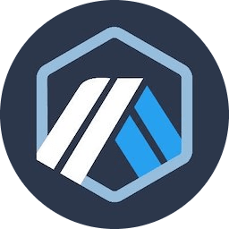 Arbitrum (ARB)

**Network:** Arbitrum One


```text
0xB9EA87b0Fa9D0F56464c7cE293E9a719cE875b90
```

<a id="optimism-op"></a>

##  Optimism (OP)

**Network:** OP Mainnet


```text
0xB9EA87b0Fa9D0F56464c7cE293E9a719cE875b90
```

<a id="polygon-pol"></a>

##  Polygon (POL)

**Network:** Polygon PoS


```text
0xB9EA87b0Fa9D0F56464c7cE293E9a719cE875b90
```

<a id="avalanche-avax"></a>

## 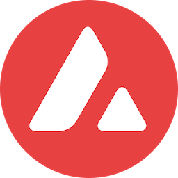 Avalanche (AVAX)

**Network:** Avalanche C-Chain


```text
0xB9EA87b0Fa9D0F56464c7cE293E9a719cE875b90
```

---

Network and token references: [Tether](https://tether.to/en/supported-protocols/), [USDT0 deployments](https://docs.usdt0.to/technical-documentation/deployments), [BNB Chain token list](https://github.com/bnb-chain/opbnb-bridge-tokens/blob/main/opbnb.tokenlist.json), [OP and Base token list](https://github.com/ethereum-optimism/ethereum-optimism.github.io/blob/master/data/USDT/data.json).

Currency icons: [Trust Wallet Assets](https://github.com/trustwallet/assets), [Cryptocurrency Icons](https://github.com/spothq/cryptocurrency-icons), and [TON media assets](https://ton.org/media/). [Sources and licenses](icons/README.md).
